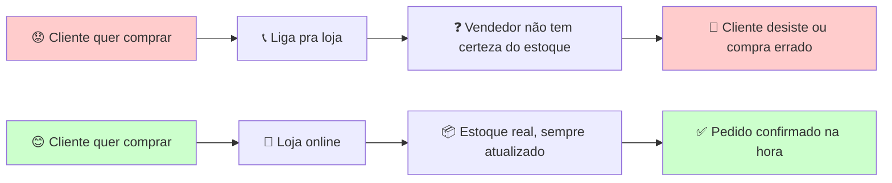
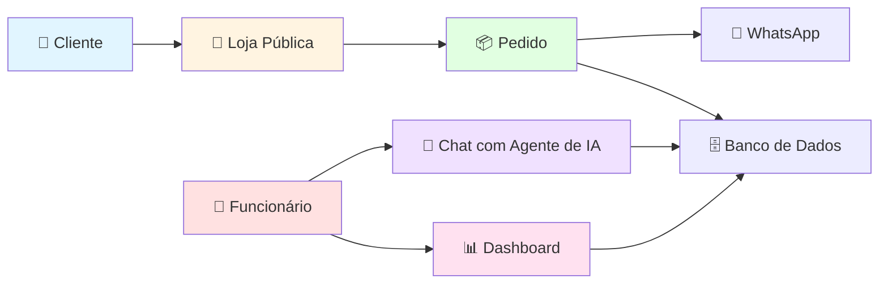
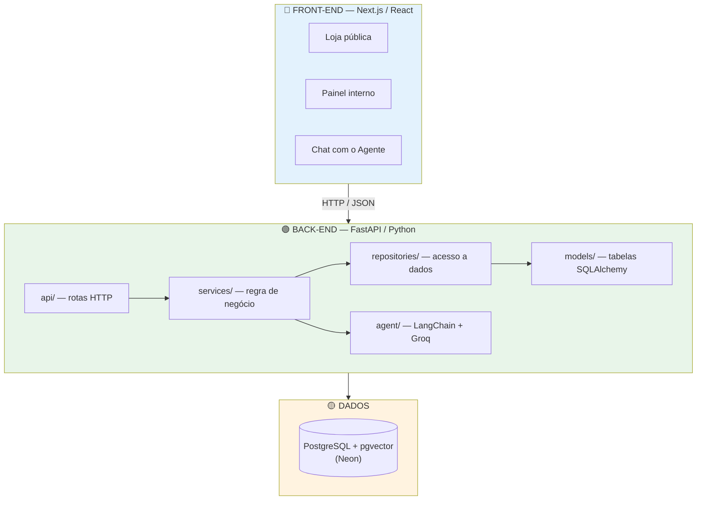
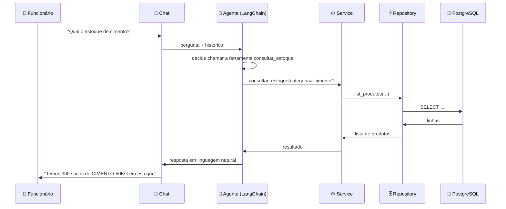
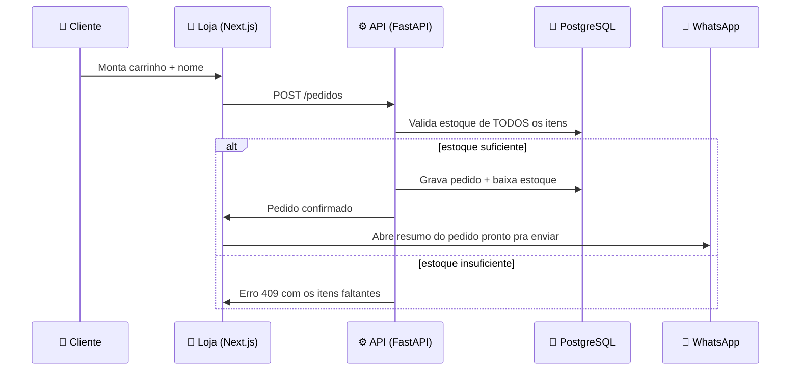

<div align="center">


# 🧱 AGENTE DE ESTOQUE
### Sistema de Controle de Estoque com Agente de IA para Materiais de Construção

[](https://construction-company-liard.vercel.app/loja)
[](https://construction-company-ljfz.onrender.com/docs)
[](./ROTEIRO_VIDEO.md)

[](https://www.python.org/)
[](https://fastapi.tiangolo.com/)
[](https://nextjs.org/)
[](https://neon.com/)
[](https://www.langchain.com/)
[](LICENSE)

**Curso:** Ciência da Computação | **Período:** [preencher] | **Semestre:** 6º | **Ano:** 2026 | **Instituição:** UNINOVE — Projeto de Extensão

</div>

---

## 👥 Equipe e Papéis

<div align="center">

| Integrante | RA | Papel Principal | Principais Entregas |
|:----------:|:--:|:----------------:|:--------------------:|
| **Eduardo Daniel** | `[preencher]` | 🔧 Backend / DevOps | API (`app/`), CI/CD, deploy (Vercel/Render/Neon) |
| **Eduardo Matheus** | `[preencher]` | 🎨 Front-end | Loja pública e painel interno (`frontend/`) |
| **João** | `[preencher]` | 🗄️ Banco de Dados | Modelagem (`app/models/`), migrations (`migrations/`) |
| **Carlos** | `[preencher]` | ✅ QA / Qualidade | Testes de integração, checklist de testes manuais |
| **Diogo** | `[preencher]` | 📄 Documentação ABNT + Vídeo | Relatório final, roteiro e gravação do vídeo |
| **Josué** | `[preencher]` | 📝 Apoio à Documentação | README, guia do projeto, plano de trabalho |

</div>

---

<a name="motivacao"></a>
## 💭 Por Que Este Projeto Existe?

### 🧱 O Problema de Quem Vende Material de Construção

Lojas pequenas e médias de materiais de construção, na maioria das vezes, controlam estoque de um jeito manual: caderno, planilha solta, ou simplesmente "de cabeça". O resultado é previsível — vendedor promete um produto que não tem mais, cliente liga pra saber se tem cimento disponível e ninguém sabe responder na hora, e pedidos anotados em papel se perdem.

### 📉 A Realidade que Nos Motivou

Durante o planejamento do projeto, olhamos pra um protótipo de referência mais simples (um agente de IA sobre um CSV estático, sem banco de dados, sem testes, sem separação de camadas) e enxergamos exatamente os problemas que uma loja de verdade teria se dependesse de algo parecido: nenhuma garantia de que o número de estoque é real, nenhum histórico de quem comprou o quê, e nenhuma forma seria de o cliente comprar sem ligar.

<div align="center">



</div>

### 💡 A Solução: Estoque que Nunca Mente

E se **toda** entrada e saída de material — venda, reposição de fornecedor, pedido feito pelo chat — passasse obrigatoriamente pelo mesmo sistema, em vez de depender de alguém atualizar uma planilha depois?

Foi assim que nasceu o **Agente de Estoque**: uma API que centraliza todo o controle, com um **agente de IA** que conversa em linguagem natural pra consultar estoque e registrar pedidos, uma **loja pública** onde o cliente compra direto, e um **painel interno** onde a equipe acompanha tudo — estoque, pedidos e um dashboard de entradas/saídas.

### 🎯 O Impacto Real

<table>
<tr>
<td width="33%" align="center">

#### 🧑‍🤝‍🧑 Para o Cliente
✅ Compra sem precisar ligar
✅ Vê o estoque real na loja
✅ Pedido confirmado na hora
✅ Resumo do pedido direto no WhatsApp

</td>
<td width="33%" align="center">

#### 🏪 Para a Loja
✅ Estoque sempre correto
✅ Zero planilha solta
✅ Histórico de toda movimentação
✅ Dashboard pra "fazer as contas"

</td>
<td width="33%" align="center">

#### 👷 Para a Equipe
✅ Chat de IA tira dúvida rápida
✅ Painel central de pedidos
✅ Sem retrabalho de contagem manual
✅ Login próprio e seguro

</td>
</tr>
</table>

### 🚀 Nossa Missão

<div align="center">

> ### *"Um número de estoque em que dá pra confiar"*
>
> Queremos que nenhuma venda se perca por falta de informação,
> que o estoque mostrado seja sempre o estoque real,
> e que uma loja pequena consiga vender online sem precisar de um sistema caro.

</div>

---

## 📖 Índice

- [💭 Por Que Este Projeto Existe?](#motivacao)
- [🎯 Sobre o Projeto](#sobre)
- [❓ Problema](#problema)
- [🤖 Tecnologias](#tecnologias)
- [🗄️ Modelo de Dados](#dados)
- [🏗️ Arquitetura](#arquitetura)
- [⚙️ Como Rodar Localmente](#instalacao)
- [🌐 Acessar Online](#online)
- [📸 Telas do Sistema](#screenshots)
- [📈 Status e Resultados](#resultados)
- [🎥 Vídeo de Demonstração](#video)
- [💡 Decisões Técnicas](#decisoes)
- [📚 Referências](#referencias)
- [📄 Licença](#licenca)
- [🙏 Agradecimentos](#agradecimentos)

---

<a name="sobre"></a>
## 🎯 Sobre o Projeto

> Sistema web completo pra controle de estoque de uma empresa de materiais de construção: **loja pública** (catálogo + carrinho + checkout via WhatsApp), **painel interno** (gestão de produtos, pedidos e dashboard) e um **agente de IA** que consulta estoque e registra pedidos por chat — sem nunca gerar SQL ou código livre, só escolhendo entre um conjunto fixo de ferramentas seguras.

### ✨ Destaques



---

<a name="problema"></a>
## ❓ Problema

### 📋 Contexto

Controle de estoque manual em pequenas lojas de material de construção gera erro, venda perdida e retrabalho. Hoje:

| ❌ Situação sem o sistema | ✅ Com o Agente de Estoque |
|---|---|
| Contagem manual, sujeita a erro humano | Toda entrada/saída passa pelo sistema — número sempre real |
| Cliente liga pra saber se tem material disponível | Loja pública mostra o catálogo e o estoque em tempo real |
| Pedido anotado em papel ou WhatsApp solto, fácil de perder | Pedido gravado no banco + resumo no WhatsApp, visível no painel |
| Sem noção de quanto entrou/saiu em valor | Dashboard com entradas, saídas e saldo estimado por categoria |
| Atendimento por IA sem controle (risco de gerar SQL/código perigoso) | Agente de IA só escolhe entre ferramentas fixas e seguras |

### 🎯 Objetivo

Construir um sistema que:
1. Garante que o **estoque mostrado é sempre o estoque real** (toda mudança passa pelo mesmo serviço, nunca é editada direto no banco).
2. Permite que o **cliente compre sozinho**, sem depender de atendimento por telefone.
3. Dá à equipe um **agente de IA seguro** — tool-calling fixo, nunca execução livre de código.
4. Oferece **visibilidade financeira básica** (dashboard) sem precisar de um ERP caro.

---

<a name="tecnologias"></a>
## 🤖 Tecnologias

### 🏗️ Arquitetura em Camadas



### 📚 Stack Tecnológico

<div align="center">

| Categoria | Tecnologia | Função |
|:---:|:---:|:---:|
| **Back-end** | FastAPI (Python 3.12, assíncrono) | API REST |
| **ORM / Migrations** | SQLAlchemy 2.x (async) + Alembic | Mapeamento e versionamento do banco |
| **Banco de dados** | PostgreSQL + pgvector (hospedado no Neon) | Armazenamento relacional |
| **Agente de IA** | LangChain + Groq (API compatível OpenAI) | Chat com tool-calling seguro |
| **Front-end** | React + Next.js (App Router) | Interface web |
| **Gráficos** | Recharts | Dashboard de entradas/saídas |
| **Empacotamento** | `pyproject.toml` + `uv` | Dependências e lockfile |
| **Testes** | pytest + pytest-asyncio | Testes automatizados (back-end) |
| **Lint** | ruff (back-end) + ESLint (front-end) | Qualidade de código |
| **CI/CD** | GitHub Actions | Lint + testes a cada push/PR |
| **Deploy** | Vercel + Render + Neon | Hospedagem gratuita, front/back/banco separados |

</div>

### 🧠 Por que o agente de IA nunca gera código livre?

O protótipo de referência que inspirou esse projeto executava código Python gerado pelo próprio modelo de linguagem, sem sandbox — uma escolha arriscada fora de um ambiente 100% local. Aqui, o agente **só escolhe qual ferramenta chamar** entre um conjunto fixo (`consultar_estoque`, `registrar_pedido`, `repor_estoque`) e com quais argumentos. Quem grava no banco é sempre código Python determinístico nosso — nunca o modelo diretamente.

---

<a name="dados"></a>
## 🗄️ Modelo de Dados

<div align="center">

| Tabela | O que guarda |
|:---:|:---|
| `produtos` | Catálogo: SKU, nome, categoria, estoque atual/mínimo, preço (e promoção/imagem) |
| `fornecedores` | Quem entrega material — criado automaticamente na reposição de estoque |
| `pedidos` | Pedidos feitos por clientes (loja pública ou chat) |
| `itens_pedido` | Itens de cada pedido (produto + quantidade) |
| `movimentacoes_estoque` | Histórico de **toda** entrada e saída — é a auditoria que garante o número real |
| `usuarios` | Login do painel interno (funcionários) — não existe cadastro público de propósito |

</div>

`quantidade` e `preço` usam `NUMERIC` (não `float`) em todo o banco — erro de arredondamento em estoque ou dinheiro não é aceitável.

---

<a name="arquitetura"></a>
## 🏗️ Arquitetura do Sistema

### 📁 Estrutura de Pastas

```
Construction_Company/
├── 📄 README.md                 ← Você está aqui!
├── 📄 GUIA_PROJETO.md           ← Guia completo de workflow do time
├── 📄 COMO_COMECAR.md           ← Onboarding pra quem entra no time
├── 📄 DEPLOY.md                 ← Passo a passo do deploy (Vercel/Render/Neon)
├── 📄 ROTEIRO_VIDEO.md          ← Roteiro do vídeo de apresentação
├── 📄 render.yaml               ← Config do back-end no Render
├── 📄 Dockerfile / docker-compose.yml
│
├── 🐍 app/                      ← BACK-END (Python / FastAPI)
│   ├── api/routes/              ← Rotas HTTP (auth, produtos, pedidos, dashboard, chat)
│   ├── services/                ← Regra de negócio (único lugar que muda estoque)
│   ├── repositories/            ← Acesso ao banco, sem decidir nada
│   ├── models/                  ← Tabelas (SQLAlchemy) + schemas (Pydantic)
│   ├── agent/                   ← Agente de IA (LangChain + Groq, tool-calling)
│   ├── rag/                     ← Reservado p/ busca documental futura (pgvector)
│   └── core/                    ← Configuração, conexão com banco, segurança
│
├── 🔄 migrations/               ← Histórico versionado do banco (Alembic)
│
├── ⚛️ frontend/                  ← FRONT-END (TypeScript / Next.js)
│   ├── app/                     ← Páginas: loja, produtos, pedidos, dashboard, login
│   ├── components/              ← Componentes (loja pública + painel interno)
│   └── lib/                     ← Funções que chamam a API do back-end
│
├── 🧪 tests/unit/                ← Testes automatizados (SQLite em memória, sem rede)
├── 🧰 scripts/                   ← Seed de dados, criação de usuário admin
└── 📚 docsprojeto/               ← Material da professora (ABNT, orientações)
```

### 🔄 Fluxo de uma Pergunta no Chat



### 🛒 Fluxo de Compra na Loja



---

<a name="instalacao"></a>
## ⚙️ Como Rodar Localmente

### 📋 Pré-requisitos

- Python 3.12+
- Node.js 20+
- Docker Desktop (banco de dados local)
- `uv` (gerenciador de pacotes Python) — `pip install uv`

### 🚀 Passo a Passo

#### 1️⃣ Clonar o repositório
```bash
git clone https://github.com/Projeto-6-semestre/Construction_Company.git
cd Construction_Company
```

#### 2️⃣ Configurar o back-end
```bash
uv sync
cp .env.example .env
# edite o .env e preencha GROQ_API_KEY (gratuito em console.groq.com/keys)
```

#### 3️⃣ Subir o banco e rodar as migrations
```bash
docker compose up -d db
uv run alembic upgrade head
uv run python scripts/seed_data.py   # opcional: dados de demonstração
```

#### 4️⃣ Rodar a API
```bash
uv run uvicorn app.main:app --reload
```
Disponível em `http://localhost:8000` — docs interativas em `http://localhost:8000/docs`.

#### 5️⃣ Rodar o front-end
```bash
cd frontend
npm install
cp .env.local.example .env.local
npm run dev
```
Disponível em `http://localhost:3000`.

#### 🧪 Rodar os testes
```bash
uv run pytest tests/unit
```

#### 🐳 Tudo via Docker Compose
```bash
docker compose up --build
```

Guia completo de onboarding em [`COMO_COMECAR.md`](./COMO_COMECAR.md).

---

<a name="online"></a>
## 🌐 Acessar Online

O projeto está no ar de verdade, sem precisar instalar nada — front-end, back-end e banco de dados cada um no seu próprio serviço gratuito:

<div align="center">

| Parte | Onde roda | Link |
|:---:|:---:|:---:|
| 🛒 **Loja pública** (cliente) | Vercel | [construction-company-liard.vercel.app/loja](https://construction-company-liard.vercel.app/loja) |
| 👷 **Painel interno** (funcionário, exige login) | Vercel | [construction-company-liard.vercel.app/login](https://construction-company-liard.vercel.app/login) |
| ⚙️ **API** (documentação Swagger) | Render | [construction-company-ljfz.onrender.com/docs](https://construction-company-ljfz.onrender.com/docs) |
| 🗄️ **Banco de dados** | Neon | PostgreSQL gerenciado (acesso interno) |

</div>

> ⚠️ O back-end roda no plano gratuito do Render, que "dorme" depois de ~15 minutos sem uso — a primeira requisição depois disso pode demorar até 1 minuto pra responder. É normal, espera carregar.

Passo a passo completo de como esse deploy foi montado em [`DEPLOY.md`](./DEPLOY.md).

---

<a name="screenshots"></a>
## 📸 Telas do Sistema

> 🚧 Prints a adicionar aqui depois da gravação do vídeo de demonstração (ver [`ROTEIRO_VIDEO.md`](./ROTEIRO_VIDEO.md)).

- Loja pública (catálogo + carrinho)
- Painel interno (estoque + chat com o agente de IA)
- Tela de pedidos
- Dashboard de entradas/saídas

---

<a name="resultados"></a>
## 📈 Status e Resultados

<div align="center">

| Item | Status |
|:---|:---:|
| Autenticação (JWT) | ✅ |
| CRUD de produtos | ✅ |
| Loja pública com carrinho | ✅ |
| Checkout com redirecionamento pro WhatsApp | ✅ |
| Agente de IA (consulta + registro de pedido via chat) | ✅ |
| Painel de pedidos | ✅ |
| Dashboard de entradas/saídas | ✅ |
| Testes automatizados | ✅ 18/18 passando |
| CI (lint + testes a cada push/PR) | ✅ |
| Deploy ao vivo (Vercel + Render + Neon) | ✅ |
| Testes de integração (Postgres real) | ⏳ pendente |
| Relatório final (ABNT) | ⏳ pendente |

</div>

### ⏱️ Performance

| Métrica | Valor |
|---|---|
| Testes unitários (back-end) | 18/18 passando, ~1.8s |
| Build do front-end | ~1s (Turbopack) |
| Cold start da API (Render, após dormir) | ~50s (plano gratuito) |

---

<a name="video"></a>
## 🎥 Vídeo de Demonstração

<div align="center">

### 🎬 Em breve

[](./ROTEIRO_VIDEO.md)

**Roteiro completo:** [`ROTEIRO_VIDEO.md`](./ROTEIRO_VIDEO.md)

**Conteúdo previsto:**
1. 👋 Apresentação da equipe e motivação do projeto
2. 🛒 Demonstração da loja pública (carrinho → WhatsApp)
3. 💬 Demonstração do painel interno e do chat com o agente de IA
4. 📊 Demonstração do dashboard de entradas/saídas
5. 🏗️ Arquitetura e organização do código
6. 🌐 Prova de que o sistema está no ar (Vercel + Render)

</div>

---

<a name="decisoes"></a>
## 💡 Decisões Técnicas

| Decisão | Por quê |
|---|---|
| **Groq** em vez de Hugging Face pro LLM | A Hugging Face removeu o crédito gratuito mensal; a Groq mantém tier gratuito de verdade e bom suporte a tool-calling |
| `NUMERIC`/`Decimal`, nunca `float`, pra estoque e preço | Erro de arredondamento em estoque significa contar material que não existe |
| Agente de IA só com tool-calling fixo | Executar código/SQL livre gerado por LLM é risco de segurança — o protótipo de referência fazia isso sem sandbox |
| `SELECT ... FOR UPDATE` ao baixar estoque | Evita condição de corrida em dois pedidos simultâneos pro mesmo produto |
| Valor do dashboard = quantidade × **preço atual** | O histórico de movimentação não guarda o preço de quando aconteceu — é deixado explícito na tela que é uma estimativa, não contabilidade exata |
| Migration roda automaticamente no deploy (`Dockerfile`) | Único ambiente de demonstração (não produção real com usuários pagantes); mais simples que migration manual nesse contexto |
| Deploy em 3 serviços gratuitos separados (Vercel + Render + Neon) | A Vercel não hospeda bem um back-end com conexão persistente ao banco; cada serviço faz a parte que faz melhor, de graça |
| Repositório público no GitHub | Necessário pro plano gratuito da Vercel aceitar deploy de repositório de organização |

---

<a name="referencias"></a>
## 📚 Referências

### 📖 Documentação oficial das tecnologias usadas

- [FastAPI](https://fastapi.tiangolo.com/) — framework do back-end
- [SQLAlchemy](https://docs.sqlalchemy.org/) — ORM assíncrono
- [Alembic](https://alembic.sqlalchemy.org/) — migrations de banco
- [LangChain](https://python.langchain.com/) — orquestração do agente de IA
- [Groq](https://console.groq.com/docs) — provedor do modelo de linguagem
- [Next.js](https://nextjs.org/docs) — framework do front-end
- [Recharts](https://recharts.org/) — gráficos do dashboard
- [Render](https://render.com/docs) / [Vercel](https://vercel.com/docs) / [Neon](https://neon.com/docs) — hospedagem do deploy gratuito

### 🎓 Acadêmicas

**Orientação:**
- **Prof(a). [preencher]**
  Projeto de Extensão — 6º Semestre — Ciência da Computação
  Instituição: UNINOVE

---

<a name="licenca"></a>
## 📄 Licença

Este projeto está sob a licença **MIT**. Veja o arquivo [LICENSE](LICENSE) para mais detalhes.

```
MIT License - Copyright (c) 2026 Projeto Agente de Estoque — Materiais de Construção
```

---

<a name="agradecimentos"></a>
## 🙏 Agradecimentos

<div align="center">

### Nossos sinceros agradecimentos a todos que contribuíram para este projeto:

</div>

- 🎓 **Prof(a). [preencher]**
  Orientação técnica e acadêmica do projeto de extensão

- 🏫 **UNINOVE**
  Suporte acadêmico e infraestrutura para o desenvolvimento

- 🤖 **Comunidade Open Source**
  Pelas ferramentas que tornaram esse projeto possível: FastAPI, SQLAlchemy, Alembic, LangChain, Next.js, React e Recharts

---

**Este projeto não seria possível sem o esforço de toda a equipe e o apoio da comunidade open source!**

---

## 📞 Contato

<div align="center">

**Dúvidas ou sugestões?**

[](https://github.com/Projeto-6-semestre/Construction_Company)
[](mailto:edwardpf02@gmail.com)

</div>

---

<div align="center">

### ⭐ Se este projeto te ajudou, deixe uma estrela!


</div>
